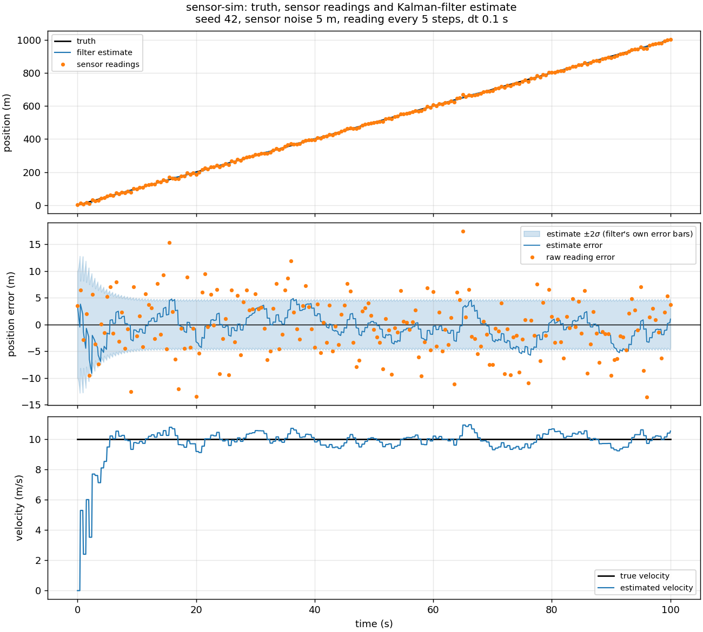

# sensor-sim: a sensor and state-estimation simulator

[](https://github.com/giba12/Aerospace/actions/workflows/ci.yml)

> **This is a small educational simulation.** It is not flight software and has not been
> qualified for any use. It does not model a real sensor, real vehicle dynamics, or
> operational sensor fusion. (SYS-006)

**Status: M5 complete (hardening); M6 (release) in progress.** Every stage of the pipeline exists and
runs. The truth model, the seeded noisy sensor and the Kalman filter are real. The filter is checked
three ways: against the baseline's hand-worked vector, against an independent Python
re-computation in exact arithmetic, and against 50 held-out random seeds (the result is recorded in
[docs/VALIDATION.md](docs/VALIDATION.md)). `analyze.py` prints the metrics, writes `metrics.json`
and draws the plot below. The whole suite also passes under AddressSanitizer and
UndefinedBehaviorSanitizer, every Must requirement has a passing test (and CI fails the build if one
loses it), and 94 % of the library's lines are covered by tests. [docs/EVIDENCE.md](docs/EVIDENCE.md)
links every claim on this page to the test, run or file that supports it. See [Limitations](#limitations).

## What this project demonstrates

Simulate an object moving in one dimension, produce imperfect sensor readings of its
position, estimate its hidden state from those readings alone, and compare the estimate with
the known truth. It is also a small demonstration of engineering habits: requirements with
IDs, tests that cite them, a script that checks the citations, CI on every push, and
deterministic runs.

## Data flow

```text
Dynamics ──truth──▶ Runner ──truth (const)──▶ Sensor ──▶ optional Measurement
                      │                                        │
                      │         Estimator ◀── measurement only ┘     (never the truth)
                      │             │
                      └─────────────┴──▶ Recorder ──▶ run.csv ──▶ python/analyze.py ──▶ metrics
```

The truth is kept apart from the estimator so the evaluation is meaningful. The full design
is in [docs/architecture.md](docs/architecture.md) and the
[systems engineering baseline](docs/systems-engineering-baseline.md).

## Units and assumptions

SI units throughout, with the unit in every CSV column, sidecar key and struct field name (`_m`, `_s`,
`_mps`); `--help` shows each flag's unit.
In the truth and the CSV, time is `t = k × dt`, computed per step, never accumulated. The model is one-dimensional,
constant velocity by default, or constant acceleration with `--accel`. Truth is advanced with
explicit Euler, which is exact when the acceleration is 0 and otherwise off by
`a·t·dt/2`, to within floating-point rounding (5 m for a = 1 m/s², t = 100 s, dt = 0.1 s; baseline VV-SIM-01).

## Prerequisites

Linux, GCC 13 or Clang 18, CMake ≥ 3.20 (only 3.28 is tested), Ninja, Python 3.12 with `venv`, and network access on
the first configure (GoogleTest is downloaded, pinned by SHA-256). Or just Docker or Podman: see
[In a container](#in-a-container-optional).

## Quick start (one command)

```bash
./run.sh
```

Run from the project folder, `./run.sh` creates the Python environment, builds the simulator, runs the reference scenario, prints the metrics and the independent cross-check, and leaves `run.csv`, `run.csv.config.json`, `metrics.json` and `plot.png` in `./out`.

The first run downloads the Python packages, which takes minutes; a later run takes under a minute. `./run.sh --test` first builds and runs the whole test suite, which also downloads GoogleTest. `./run.sh --clean` starts from scratch, and `./run.sh -- --sigma 2 --seed 7` passes flags to the simulator. If a required tool is missing, the script says which.

## Build, test, run, analyze

```bash
# 1. Python environment (pinned)
python3 -m venv .venv
.venv/bin/pip install -r python/requirements.txt

# 2. Configure and build (warnings are errors; see Troubleshooting)
cmake -S . -B build -G Ninja
cmake --build build

# 3. Test (C++ unit tests, Python system tests; JUnit XML goes to build/test-reports/)
cd build && ctest --output-on-failure && cd ..

# 4. Run the simulator, then analyze its output (needs run.csv.config.json next to the CSV)
./build/sim --steps 1000 --out run.csv     # also writes run.csv.config.json (settings, seed, build)
.venv/bin/python python/analyze.py run.csv --metrics-json metrics.json --plot plot.png

# 5. Cross-check the filter against the independent Python re-computation (exact arithmetic)
.venv/bin/python python/kalman_oracle.py run.csv

# 6. Check requirement traceability. With --require-coverage this FAILS if any Must
#    requirement has no passing test, exactly as CI does
.venv/bin/python tools/req_trace.py --requirements docs/requirements.csv \
    --junit build/test-reports/gtest.xml build/test-reports/pytest.xml --require-coverage

# 7. Check the suite stayed inside its 30 second budget (NFR-006)
.venv/bin/python tools/check_budget.py --junit build/test-reports/gtest.xml build/test-reports/pytest.xml
```

### Sanitizers and coverage (optional, each in its own build directory)

```bash
# AddressSanitizer + UndefinedBehaviorSanitizer: any finding aborts, so it fails the test
cmake -S . -B build-asan -G Ninja -DSIM_SANITIZE=ON
cmake --build build-asan && (cd build-asan && ctest --output-on-failure)

# Line and branch coverage of src/ and include/ (HTML report in build-cov/coverage/index.html)
cmake -S . -B build-cov -G Ninja -DSIM_COVERAGE=ON
cmake --build build-cov && (cd build-cov && ctest) && cmake --build build-cov --target coverage
```

The sanitizer build takes about twice as long to run and the coverage build is unoptimised, so neither is
held to the 30 second budget. The two options cannot be combined.

`./build/sim --help` lists every flag with its unit and default.

### In a container (optional)

A clean-room alternative to installing the toolchain: the image builds the program from a fresh copy of
the source, installs the pinned Python packages, **runs the whole test suite inside the image**, and then
runs the reference scenario. An image that exists is an image whose tests passed (unless it was built
with `RUN_TESTS=0`, below).

```bash
# Docker
docker build -t sensor-sim .
mkdir -p out && docker run --rm --user "$(id -u):$(id -g)" -v "$PWD/out:/out" sensor-sim

# Podman (rootless). It needs a different flag: see the note below
podman build -t sensor-sim .
mkdir -p out && podman run --rm --userns=keep-id -v "$PWD/out:/out" sensor-sim
```

The run prints the metrics and the independent cross-check, and leaves `run.csv`,
`run.csv.config.json`, `metrics.json` and `plot.png` in `./out`.

**Why the two commands differ.** With rootless Podman, `--user` maps to a different host user from the one
that owns `./out`, so the container cannot write there (`cannot open for writing`); `--userns=keep-id`
keeps your own user. If your `docker` command is really Podman (as in this project's WSL setup, where it
prints "Emulate Docker CLI using podman"), use the Podman line.

- The build needs a network (apt, pip, and the GoogleTest download); the run does not.
- `docker build --build-arg RUN_TESTS=0 -t sensor-sim .` skips the in-image tests for a quick demo.
- The base image is pinned by digest, which bounds the compiler and CMake versions. The individual apt
  packages are not pinned, so a rebuild months later can differ slightly.
- The image runs as a non-root user and contains no secrets; `.dockerignore` keeps the git history and
  local environments out of the build.
- The build compiles GoogleTest and the project from scratch: expect a few minutes (about 8 under rootless
  Podman on the WSL machine this was developed on, about 1.5 on CI).
- Checked once, on 2026-11-05 with Podman: the container's `run.csv` was byte-identical to a native run's, and
  its `plot.png` and `metrics.json` to `data/example-plot.png` and `data/example-metrics.json`. That holds
  because both used GCC 13.3 and the same standard library. The sidecar differs only in `source_revision`,
  which is `null` in the image because it has no git history.

## Expected output

The sensor adds Gaussian noise (default sigma 5 m, seed 42) and the Kalman filter estimates position
and velocity from those readings alone. The RMSEs are taken at the 201 steps that have a reading:
the raw readings are off by 5.46 m, the filter's position estimate by 2.32 m (a ratio of 0.43), and
its velocity estimate, which the sensor never measures, by 1.20 m/s:

```text
n_rows = 1001
n_measurements = 201
rmse_meas_pos_m = 5.4598541120696265
rmse_est_pos_m = 2.32142058992441
rmse_est_vel_mps = 1.2027805245829981
n_within_2sigma = 189
frac_pos_within_2sigma = 0.9402985074626866
```

`frac_pos_within_2sigma` is the share of those 201 positions whose error is inside twice the filter's
own reported standard deviation (94 % for this seed).

This is one seed. Across 50 held-out seeds (never used to choose any setting) the estimate's RMSE is
0.31 to 0.56 times the raw readings' RMSE, against a required 0.75 (EST-008), and 97.6 % of the
true positions fall inside the filter's own +/-2 sigma error bars, against a required 90 %
(EST-012). A perfect filter scores about 95 %.

The noise values come from the C++ standard library's `std::normal_distribution`, which the
standard leaves implementation-defined. The same seed gives identical output on the same platform
and build. The digits above are from GCC 13.3 with libstdc++; Clang 18 with the same library prints the
same digits (a test checks this block against a fresh run, on both compilers in CI), but a different
standard library (libc++, MSVC) may not.
`--sigma 0` gives an exact sensor, and the sidecar `run.csv.config.json` records every setting except
the output path.

The plot (`data/example-plot.png`, from the command in step 4) shows the three things worth seeing. Top:
the truth, the noisy readings and the filter's estimate. Middle: the position *error* of the estimate
against the raw readings' error, with the filter's own +/-2 sigma bars shaded; the blue error is inside
the band at 189 of the 201 readings (94 %) and hugs zero while the orange readings scatter wider. Bottom:
the velocity, which the sensor never measures, within 1 m/s of the true 10 m/s from about 5 s on.



`analyze.py` refuses a CSV whose sidecar is missing, has a `schema_version` it does not understand, or
describes a different run (ANA-001); it writes `metrics.json` in the layout of baseline section 8.7
(`improvement_ratio` is `null` for an exact sensor, where the raw error is 0). An example is
`data/example-metrics.json`.

## Repository layout

| Path | Contents |
|---|---|
| `include/simulator/`, `src/` | `simcore` library (all logic) and `main.cpp` (one call into it) |
| `tests/support/` | Framework-neutral test helpers and fakes |
| `tests/gtest/` | GoogleTest adapter. The only place that knows the framework |
| `tests/system/`, `tests/python/` | pytest: black-box tests of `sim`, and unit tests of the Python tools |
| `python/` | `analyze.py` (metrics, JSON, plot), `kalman_oracle.py` (independent re-computation), `ensemble.py` (runs many seeds, VAL-02/03), `seed_sets.py`, and the pinned `requirements.txt` |
| `data/` | A small example plot and metrics file |
| `tools/req_trace.py`, `tools/check_budget.py` | Requirement-to-test traceability and its CI gate; the 30 s test-time budget |
| `docs/` | Requirements, baseline, architecture, `VALIDATION.md` (the VAL-02/03 record), `EVIDENCE.md` (claim-to-evidence table), change requests, and `requirements.csv` (the ID registry) |

## Writing a test

Every test names the requirement it verifies:

```cpp
TEST(Runner, CallOrderMatchesSpecification) {
    RecordProperty("requirements", "RUN-001");   // GoogleTest
```

```python
@pytest.mark.req("OUT-001")                       # pytest
def test_header(...):
```

`tools/req_trace.py` fails on an unknown ID or on a test that cites none.

## Limitations

- The filter assumes constant velocity, so it fails when the truth accelerates. Measured on 200 tuning
  seeds with the real filter: at `--accel 0.1` it still helps (RMSE ratio 0.46, error-bar coverage
  96 %); at `--accel 0.5` it is no better than the raw readings (ratio 1.05) and the true position
  is inside its own error bars only 42 % of the time. The acceptance tests (EST-008, EST-012) use
  the reference scenario with no acceleration and say nothing about this case.
- The filter's `q` and `R` are the baseline's reference values (0.1 and 25) and have not been tuned for any scenario.
- Sensor noise depends on the C++ standard library's normal distribution (see Expected output).
- One dimension. Acceleration, if any, is constant and known; Euler's error bound is `a·t·dt/2`.
- Validation is on simulated data from the model the filter assumes, and the exact figures depend on the
  C++ standard library's normal distribution. See `docs/VALIDATION.md` for what it does and does not show,
  including a scenario (a reading only every 5 s) where the filter helps much less than in the reference one.
- All 61 Must requirements have a passing test, but they are not all verified the same way. Several
  (NFR-001, NFR-005, SYS-005, SYS-006, DOC-001, TST-002, TST-008, TST-009) are verified by *automated
  inspection* of the build files, the CI workflow and the documents (`tests/python/test_configuration_rules.py`),
  as the baseline's verification matrix plans. They stop that configuration drifting; they are not behaviour
  tests. That CI really builds with both compilers on every push is shown by CI's own history.
- Coverage, measured on 2026-11-05: about 94 % of lines (94.0 % on the development machine, 94.5 % on CI),
  100 % of functions, and 85 to 87 % of branches with compiler-generated exception edges excluded (59.6 %
  locally with them). Of the lines not covered, 12 are `std::function` bookkeeping in the flag table that
  gcov reports even though the lambda bodies run, one more in the sidecar writer looks like the same
  artifact (not investigated), and the rest are error paths that need fault injection to reach: a failed
  final write, and a sidecar that cannot be committed after the CSV was. GCC 13 cannot report condition
  coverage. The 90 % line goal is reported, never a gate.
- The 30 second budget is checked on every normal CI build. On the slow WSL machine this was developed on
  the suite took 12 s with the machine idle (load average 1.4), 24 s under moderate load and 47 s under heavy
  load (which fails the check), so the margin there depends on what else is running; on CI it takes 5 s (GCC)
  to 14 s (Clang).
- CI runs on every push: GCC 13 and Clang 18 builds with warnings as errors, a sanitizer job, a coverage
  job and a container job.

## Next steps

Finish M6: the remaining validation records (VAL-05, VAL-06, VAL-08) and tagging the baseline (NFR-010).
The optional second test framework (Catch2, TST-010) was not built. See baseline section 6.7.

## Troubleshooting

- *A newer compiler fails the build on a warning:* configure with `-DSIM_WARNINGS_AS_ERRORS=OFF`.
- *`system.pytest` is "Not Run" with "Could not find executable" `.venv/bin/python`:* create the virtual environment (step 1).
- *Offline:* the first configure needs network access to fetch GoogleTest.
